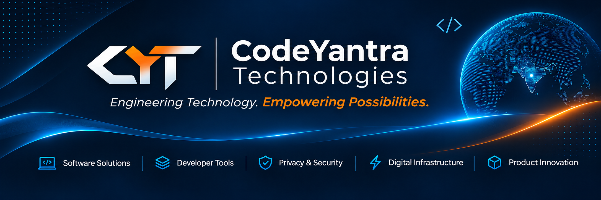

  

# CodeYantra Technologies

### Engineering Technology. Empowering Possibilities.

Independent software and technology company based in India.

[Website](https://codeyantra.in) · [Contact Us](mailto:support@codeyantra.in)

---

## About Us

CodeYantra Technologies builds practical software, developer tools, privacy-focused applications, and secure digital infrastructure.

Our mission is to make technology accessible, reliable, and meaningful through thoughtful engineering and purposeful innovation.

## Our Product Ecosystem

| Product | Focus |
| :--- | :--- |
| **FuelMate** | Efficient Fuel Management |
| **MaskChat** | Privacy-focused communication |
| **Easy Invoice** | Simplified business billing |
| **Shunya Launcher** | Innovative Android experiences |

## Research & Development

We are exploring new possibilities across:

- Application security and digital infrastructure
- Artificial intelligence
- Offline-first software
- Developer productivity tools
- Digital payment technologies

## Open Source

At CodeYantra Technologies, we believe in building
practical tools that empower the developer community.

### Featured Project

#### DevCaught

A unified local development inbox for capturing
test emails, synthetic SMS, and JSON webhooks.

- Local SMTP email capture
- SMS and webhook testing
- Unified developer inbox
- Local-first architecture
- Open source under the MIT License

[Explore Repository](https://github.com/CodeYantra-Technologies/devcaught) · [Report an Issue](https://github.com/CodeYantra-Technologies/devcaught/issues)

---

We welcome developers, contributors, and security
researchers to collaborate with us and help build
better technology.

## Our Engineering Principles

- **Security by Design** — Build with security in mind.
- **Privacy by Default** — Respect user data and choices.
- **Purposeful Innovation** — Solve meaningful problems.
- **Responsible Engineering** — Prioritize reliability and maintainability.
- **Continuous Improvement** — Learn, refine, and evolve.

## Connect With Us

- Website: [codeyantra.in](https://codeyantra.in)
- Email: [support@codeyantra.in](mailto:support@codeyantra.in)
- Location: India

---

**Built in India. Designed for the World.**

© 2026 CodeYantra Technologies

